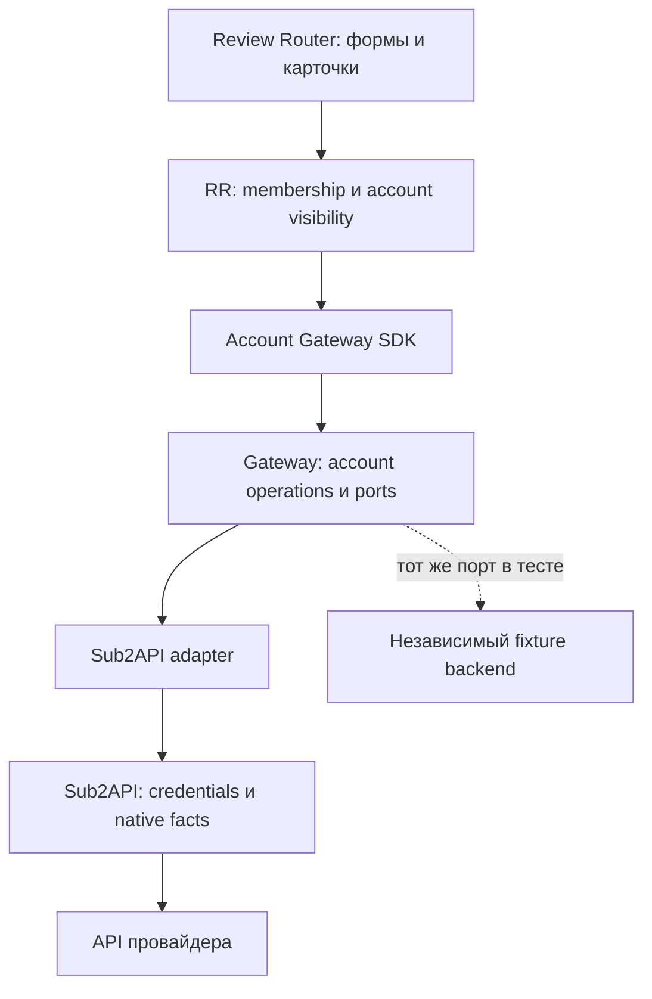
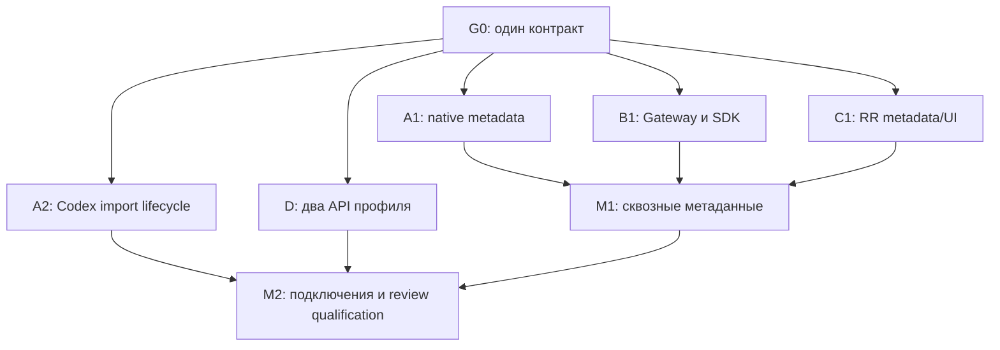

# Нативные аккаунты: основной план интеграции

## 1. Решение и границы документа

Дата исследования: **19 ноября 2026 года**. Статус: **план реализации**, не реализованная функциональность и не разрешение на production rollout. Каноническое место комплекта — Account Gateway: именно он владеет переиспользуемым контрактом управления аккаунтами. Пакеты для других репозиториев ссылаются на этот контракт, а не создают его копии.

Реализуем два последовательных результата:

1. **M1 — нативные сведения существующих аккаунтов:** email, фактический тариф, корректно названные даты и доступная безопасная дополнительная информация, с общим отображением.
2. **M2 — приоритетные подключения:** Codex refresh token и обычный refreshable `auth.json`, reconnect личного Codex, прямые API key профили Anthropic и Gemini. Существующие browser/device/key способы сохраняют свои реальные ограничения.

Sub2API остаётся единственным владельцем provider facts, credentials, provider HTTP, refresh, quota/cooldown и native scheduling. Account Gateway владеет публичным контрактом, логической идентичностью, областью владельца, операциями create/reconnect/delete и адаптером к текущему backend. Review Router владеет членством, привязками к workspace, политикой использования для ревью и видимостью информации пользователю.

Заменяемость означает: **другой account backend можно подключить к узким портам Gateway, сохранив SDK, пользовательские сценарии и общую машину account operations**. В этой работе не строится второй production backend и не обещается перенос уже выданных credentials между системами без отдельной миграции.

## 2. Как читать и распределять работу

| Документ | Владелец работы | Что в нём является авторитетным |
| --- | --- | --- |
| [Контракты и инварианты](native-account-contracts.md) | Один интегратор Gateway + проверка native/RR | Формат безопасных фактов, версии capabilities, секретные входы, semantics ошибок и границы доверия |
| [Пакет A — Sub2API](native-account-sub2api.md) | Native engineer | Snapshot, extraction, refresh/import lifecycle, native migrations |
| [Пакет B — Gateway](native-account-gateway.md) | Gateway engineer | Ports, facade/SDK, identity/authorization, reusable management |
| [Пакет C — Review Router](native-account-review-router.md) | Consumer/UI engineer | Авторизованная проекция, Get Modular slice, формы и четыре пути AccountView |
| [Пакет D — API-профили](native-account-provider-profiles.md) | Provider engineer | Anthropic/Gemini protocol support, ограничения и review qualification |
| [Квалификация и выпуск](native-account-qualification.md) | Интегратор и владельцы репозиториев | Проверки, exact artifact, миграции, последовательность выпуска |
| [10 кругов ревью](native-account-review-log.md) | Независимые reviewers + интегратор | Реальные замечания, исправления, оставшиеся ограничения |

Общие DTO и инварианты определены **один раз** в contracts. Пакеты описывают реализацию и ссылаются на них. Если меняется контракт, сначала изменяется contracts и его fixtures, затем затронутые пакеты. Таблицы задач не являются второй спецификацией wire.

## 3. Проверенная исходная точка

| Репозиторий | Исследованный commit | Существенное состояние |
| --- | --- | --- |
| [Account Gateway](https://github.com/agent-teams-ai/account-gateway/tree/1dce5c327d14e9c0e5466da91441faa0d0ae38a5) | `1dce5c327d14e9c0e5466da91441faa0d0ae38a5` | SDK, durable operations, protected native adapters, limits/models уже существуют |
| [Sub2API](https://github.com/agent-teams-ai/sub2api/tree/cfe50b7fd2aef08a7a17f11132cae73293804389) | `cfe50b7fd2aef08a7a17f11132cae73293804389` | Богатый admin UI; protected Gateway path существенно уже; безопасного общего AccountInfo ещё нет |
| [Review Router](https://github.com/777genius/review-router-ai/tree/f1cde67a2baf7416ea1d2341f6c9a98e64750aa4) | `f1cde67a2baf7416ea1d2341f6c9a98e64750aa4` | Единый Connections list уже есть; actual subscription не является текущим planLabel |

Перед реализацией владелец каждого пакета повторно сверяет HEAD и открытые изменения только в затрагиваемых местах. Эти commits — воспроизводимая база исследования, а не предписание откатить более новую работу.

Ключевые подтверждённые ограничения:

- Публичный Account в Gateway не содержит email/actual plan. Нельзя просто расширить RR карточку и получить данные. [SDK contracts](https://github.com/agent-teams-ai/account-gateway/tree/1dce5c327d14e9c0e5466da91441faa0d0ae38a5/packages/account-gateway/src/features/facade-client/contracts).
- `connection.planLabel` в RR — название connection profile/product. Его нельзя выдавать за тариф конкретного аккаунта. [Account projection](https://github.com/777genius/review-router-ai/blob/f1cde67a2baf7416ea1d2341f6c9a98e64750aa4/apps/web/src/server/account-gateway-accounts.ts).
- Admin import и protected native enrollment имеют разные требования. Старый raw OAuth ingress не даёт готового безопасного import: runtime его отвергает. [Facade](https://github.com/agent-teams-ai/account-gateway/blob/1dce5c327d14e9c0e5466da91441faa0d0ae38a5/services/account-gateway/src/facade.ts).
- Native connect intent рассчитан на browser/device. Для импорта требуется **method-aware расширение существующей таблицы/FSM**, а не вызов admin RefreshToken из HTTP handler. [Connect service](https://github.com/agent-teams-ai/sub2api/blob/cfe50b7fd2aef08a7a17f11132cae73293804389/backend/internal/service/native_gateway_oauth_connect.go), [migration 251](https://github.com/agent-teams-ai/sub2api/blob/cfe50b7fd2aef08a7a17f11132cae73293804389/backend/migrations/251_gateway_oauth_device_connect.sql).
- AccountView строится четырьмя путями, включая hydration выбранного аккаунта для модели. Только обновление списка недостаточно. [Selected account projection](https://github.com/777genius/review-router-ai/blob/f1cde67a2baf7416ea1d2341f6c9a98e64750aa4/apps/web/src/server/gateway-model-account-options.ts).

## 4. Точный scope

| Провайдер/профиль | Что делаем в этой волне | Что честно показываем |
| --- | --- | --- |
| OpenAI Codex | Текущие browser/device; RT; обычный OAuth auth.json с RT; личный reconnect | Email/plan/expiry только из доверенного native наблюдения; отдельная provenance; product label отдельно |
| Anthropic | Новый **официальный API key** профиль; факты уже существующих профилей в пределах разрешённого read path | Доступные факты; отсутствие email/плана — допустимый результат, API key не равен Claude Pro/Max |
| Gemini | Новый **официальный Gemini API key** профиль | Доступные key/project facts; не выводить Google AI Pro из факта наличия API key |
| Grok | Существующий flow, безопасные факты и общее отображение | Только полученные/проверенные identity/tier facts, без копии admin extraction в Gateway |
| OpenRouter, NVIDIA, MiMo | Существующие key flows и safe metadata contract | Известный продукт, отдельно account facts; не называть credit limit подпиской |
| Kimi Coding, Zhipu GLM, MiniMax | Существующие key flows; сохранять доступные native plan facts из уже получаемых ответов | GLM level/MiniMax subscription title при наличии; неизвестные значения не заменять выдуманным тарифом |

Полная поддержка metadata означает: каждый включённый профиль имеет определённый результат `known / unknown / unsupported / unavailable`, правильную visibility и отображение. Это не гарантия, что каждый провайдер отдаёт одинаковый набор полей.

**Вне scope:** OpenAI direct API key; AT-only, mobile RT, Codex PAT, Agent Identity; новые Claude subscription OAuth/cookie/setup-token потоки; Gemini CLI/Google One OAuth; Antigravity; новые DeepSeek/TypeSafe/OpenCode/Command Code/Cline; Bedrock/Vertex; произвольный base URL; весь admin catalog; новый scheduler, multi-backend failover, auth framework, feature-flag platform, полная миграция legacy composition, переписывание quota UI или account deletion flow.

Неопределённый внешний формат не принимается как «похожий auth.json». Для входов вне выбранного union возвращается конкретная безопасная ошибка. Часть существующих аккаунтов можно отображать, даже если создание такого типа в RR намеренно недоступно.

## 5. Простая архитектура и владельцы знаний

Это схема вызовов. Направление зависимостей кода задаётся портами: application Gateway определяет нужные ему операции, concrete Sub2API adapter реализует их и подключается в composition root. RR application не знает native wire и provider SDK. В Go остаётся native ответственность; TypeScript не добавляется внутрь Sub2API ради единообразия.

| Знание/состояние | Единственный владелец | Допустимая проекция наружу |
| --- | --- | --- |
| Credential, refresh token, provider HTTP/claims | Sub2API | Только write-only input и safe result, никогда secret readback |
| Фактические email/plan/dates/provenance | Sub2API | Typed AccountInfo; cache только в native |
| Логический accountRef, ownerRef, operations, epoch | Gateway | SDK contract, opaque identity; не email как ключ |
| Какие native профили реально скомпонованы | Native composition/catalog | Bounded capability snapshot |
| Какие из них разрешены конкретному Gateway deployment | Gateway policy/registration | Пересечение с native capability, не новая provider база |
| Членство, sharing, binding и право видеть identity | Продукт-потребитель | Разрешённая пользователю проекция |
| Model protocol/admission и quota | Существующие native/Gateway владельцы | Отдельные capabilities/limits, не вычисление из planLabel |

Одна нормализация provider фактов в native и один безопасный контракт в Gateway — осмысленные границы. Механические DomainAccount → ServiceAccount → GatewayAccount → UIAccount с одинаковыми полями запрещены. В RR нужна лишь одна минимальная проекция там, где меняется visibility; она же используется всеми карточками.

## 6. Clean Architecture, SOLID, DDD и DRY в этой работе

| Принцип | Практическое решение | Как проверяем |
| --- | --- | --- |
| Clean Architecture / DIP | Узкие consumer-owned ports, concrete backend выбран на краю | Новый fake backend не импортирует Sub2API; inner layers не импортируют HTTP/Prisma/provider DTO |
| SRP | Native интерпретирует факты, Gateway управляет аккаунтом, RR определяет viewer scope | Нет plan parsing в JSX/SDK, нет workspace roles в native |
| OCP | Добавление выбранного профиля меняет native adapter/catalog и qualification, а не provider switch во всех слоях | Новый профиль проходит общий контракт без новой карточки/operations engine |
| LSP | Fixture и native adapter имеют одинаковые unknown/error/fence гарантии | Общий conformance scenario; unsupported не маскируется под success |
| ISP | AccountInfo read, выбранный credential import, existing lifecycle capability | Нет мегапорта со всеми provider endpoints |
| DDD | Account operation — существующая транзакционная модель Gateway; native fact snapshot — read model | Нет второго Account aggregate/AccountRepository и дублирующей lifecycle таблицы |
| DRY | Один provider extractor, один canonical capability snapshot, одна форма каждого input kind | Native admin и protected path переиспользуют только подходящую чистую часть; разные security guards сохраняются |

Здесь библиотечность не означает вынос PostgreSQL/kernel в каждый consumer. Переиспользуемый продукт — существующий Gateway SDK плюс отдельный Gateway service с заменяемым account adapter. Новый consumer должен подключиться через public package exports без кода из Review Router.

## 7. Get Modular и Engineering Foundation: точное применение

| Проект | Проверенное состояние | Изменение в выбранной волне |
| --- | --- | --- |
| Gateway SDK | Core/Assembly `0.2.0`, Foundation `3.0.0`, FMS v1 scoped; CMS adoption pending | Расширить существующую `facade-client`; существующая management factory возвращает расширенный client; не создавать новый graph и не объявлять CMS adopted |
| Review Router | Core/Assembly `0.7.0`, Foundation `2.1.0`; account-limits — узкий governed slice | Новый account-metadata slice с отдельной scoped adoption, descriptor/declaration/module/group/root по проверенному pin, реальный вызов composed API |
| Sub2API | Go native code и собственные существующие boundaries | Не внедрять TS DI/runtime; сохранять native ports, service/repository и Go gates |

Основания: [Gateway composition decision](https://github.com/agent-teams-ai/account-gateway/blob/1dce5c327d14e9c0e5466da91441faa0d0ae38a5/docs/COMPOSITION.md), [RR profile](https://github.com/777genius/review-router-ai/blob/f1cde67a2baf7416ea1d2341f6c9a98e64750aa4/architecture/review-history/consumer-module-profile.json), [RR governed roots](https://github.com/777genius/review-router-ai/blob/f1cde67a2baf7416ea1d2341f6c9a98e64750aa4/architecture/foundation/provider-seams.yaml), [Engineering Quality Standard](https://github.com/agent-teams-ai/.github/blob/c8f3e7ba220241f79292c84c72712653019aa1df/docs/engineering-quality-standard.md).

Новые maintained JS-runtime файлы — TypeScript, compiler не ниже `7.0.2`, exact consumer pins сохраняются. Foundation остаётся development tooling, не runtime dependency. Успешный bootstrap или наличие пакета не считается архитектурной квалификацией: нужны точные governed roots, rejecting fixtures и тест настоящего production wiring.

## 8. Порядок работ и параллельность

### Дополнительное предреализационное ревью

По запросу владельца от 19.11.2026 работа продолжена от документов до реализации, доступных E2E, review/fix и merge, **без production deploy**. Коммиты публикуются сразу после создания; локальные незапушенные цепочки не накапливаются. До публикации соблюдаются действующие repository author/committer rules; недоступность одного transport не разрешает их обход.

Уточнения для минимальной реализации: native capabilities строятся из реально скомпонованных Config/profile, snapshot использует закрытый набор источников и один merge helper, quota+facts пишутся существующей транзакцией. Gateway расширяет facade-client и добавляет одну bounded set-based authority observation без новой facts database. RR использует существующие server-first ответы и один final enrichment после всей hydration. Отдельные scheduler, provider DSL, UI polling/cache и новые account aggregates не нужны. Эти ограничения не снимают privacy, source-order и operation recovery guarantees.

**G0 — freeze небольшого контракта.** Один интегратор фиксирует contracts, native/private examples, safe SDK examples, пределы запросов, selected profiles/methods и visibility. Reviewers каждого репозитория проверяют свои границы. Это рабочий engineering checkpoint, не дополнительное согласование с пользователем.

После G0 можно параллельно вести:

- **A1:** Native safe metadata snapshot и extractors.
- **B1:** Gateway AccountInfo/capabilities contracts, port и SDK на независимом fixture.
- **C1:** RR metadata feature, четыре проекции и UI на SDK fixture.
- **D1/D2:** Anthropic/Gemini profiles, по отдельному владельцу private adapter; общий registry файл интегрирует один native owner.
- **A2:** Codex import method/FSM migration — после утверждения native method invariants, независимо от UI metadata.
- **B2/C2:** Existing operation import integration и общая форма — после стабилизации import receipt/secret contract; до native merge используются fixtures.

Параллельно писать код можно раньше полной native реализации; включать capability для пользователя — только после producer/consumer qualification. M1 может выпускаться отдельно от M2. Общие contracts, SQL migration numbering, native registry, SDK pack/provenance и четыре RR entrypoints имеют по одному интегратору. Команды не редактируют один checkout параллельными negative-fixture gates; для реализации используют отдельные worktrees.

## 9. Оценка объёма без двойного счёта

Это **единая каноническая оценка** после девяти кругов проверки, а не измеренная будущая diff. Production включает новые/существенно изменённые maintained Go/SQL/TS и handwritten generator справочника. Последняя колонка включает содержательные tests, fixtures и verification tooling; это не только unit tests. Generated JSON, SDK archives, lockfiles, документация и release coordination в LOC не включены. Перемещения готовых строк не считаются новой реализацией. Каждая строка работы ниже учитывается один раз.

| Пакет и фаза | Production LOC | Tests/fixtures/verification LOC |
| --- | ---: | ---: |
| A / M1: native snapshot, sources/order, labels, atomic observations, hydration, deployed capabilities | 1 600–2 600 | 800–1 300 |
| B / M1: Gateway AccountInfo, первоначальный v2, batch authority, SDK | 1 100–1 800 | 700–1 150 |
| C / M1: RR visibility, четыре projections, общий UI, scoped module | 900–1 500 | 800–1 350 |
| **M1, сумма** | **3 600–5 900** | **2 300–3 800** |
| A / M2: RT + full auth.json, один existing FSM, custody/migration/recovery | 900–1 400 | 450–750 |
| B / M2: import/intent integration, adapters и небольшая profile registration | 800–1 500 | 650–1 150 |
| C / M2: формы, personal reconnect/journal compatibility, product admission | 1 000–1 700 | 750–1 300 |
| D / M2: Anthropic/Gemini native profiles, final auth-header policy, bounded signature codec | 1 300–2 200 | 1 200–2 100 |
| **M2 дополнительно, сумма** | **4 000–6 800** | **3 050–5 300** |
| **Полный выбранный результат M1 + M2** | **7 600–12 700** | **5 350–9 100** |

Для планирования людей те же строки, сгруппированные по репозиториям; **не прибавлять** эти числа к общей сумме:

| Репозиторий, M1+M2 | Production | Tests/fixtures/verification |
| --- | ---: | ---: |
| Sub2API, A + D | 3 800–6 200 | 2 450–4 150 |
| Account Gateway, B | 1 900–3 300 | 1 350–2 300 |
| Review Router, C | 1 900–3 200 | 1 550–2 650 |

В RR последняя колонка включает 250–450 строк qualification/tooling сверх 1 300–2 200 собственно targeted tests/fixtures. В остальных пакетах verification fixtures уже включены. Отдельного production surcharge «пакет квалификации» нет. Будущий отдельный PR удаления временной capability v1 — следующее migration action, не скрытая прибавка к M1/M2; его owner/removal критерий включён в план.

**Изменение прежней оценки явно:** первоначальные 1 800–3 200 production / 1 000–1 800 tests для M1 и 6 000–11 000 / 3 000–6 000 для полной волны после проверки недостаточны для всех зафиксированных гарантий. Уточнены native source ordering/withdrawal, однократное заполнение старых аккаунтов, общий label authority, batch/privacy fences, реальные CMS proofs, method-aware RR journal и protected protocol gaps. Нельзя сохранить старую низкую оценку, молча выбросив эту работу или назвав fixtures доказательством live integration.

Сложность не означает необходимость нового framework: обязательны один existing operations engine, один native snapshot owner, один consumer read slice и общие формы. Если реализация переиспользует больше существующего кода и проходит те же behavioral gates, фактическая diff может быть меньше; диапазон не является целевым количеством строк.

RT и full JSON считаются **вместе**, поскольку используют один fenced exchange/FSM. Раннее предположение о 120–220 строках RT-обёртки отвергнуто. Native parser/MAC/FSM/SQL не считаются повторно в B; common key forms и product admission не считаются отдельно для каждого provider в D. D0 должен подтвердить Gemini continuation и tool semantics без нового durable store/переделки runner. Если это не проходит, D2 остаётся незавершённым и его дополнительный scope оценивается отдельно; верхняя граница таблицы не обещает универсальный Gemini.

Календарный срок нельзя надёжно вывести из LOC. После G0, D0 и первого сквозного M1 среза обновить оценки по фактической diff, available test identities и remaining critical path. A/B/C можно вести параллельно; D0 не блокирует M1. Такой порядок даёт ранний полезный результат без обещания неподтверждённой даты полного M2.

## 10. Что считается завершением

1. Для каждого выбранного существующего профиля есть корректный AccountInfo result; provider identity/plan не вычисляются в RR/Gateway.
2. Email, actual plan и даты одинаково работают в personal/workspace/overview/selected-account путях; borrower не получает чужую identity.
3. Codex RT/full JSON create и reconnect проходят durable operation recovery; потерянный ответ не создаёт новый аккаунт и не запускает слепой повтор обмена.
4. Anthropic/Gemini key profiles проходят **реальный выбранный review protocol/tool flow**. Наличие key формы или успешный `/models` недостаточны.
5. Snapshot недоступен — существующее ревью продолжает работать при валидном execution account; metadata не управляет model admission.
6. Независимый backend fixture проходит тот же management contract; новый consumer использует packed SDK без RR/native imports.
7. Exact artifacts и migrations квалифицированы; release evidence различает source checks, synthetic E2E, live-provider test и production observation.

Все пункты — будущие acceptance criteria. Этот комплект документов сам по себе не доказывает выполнение ни одного runtime пункта.
